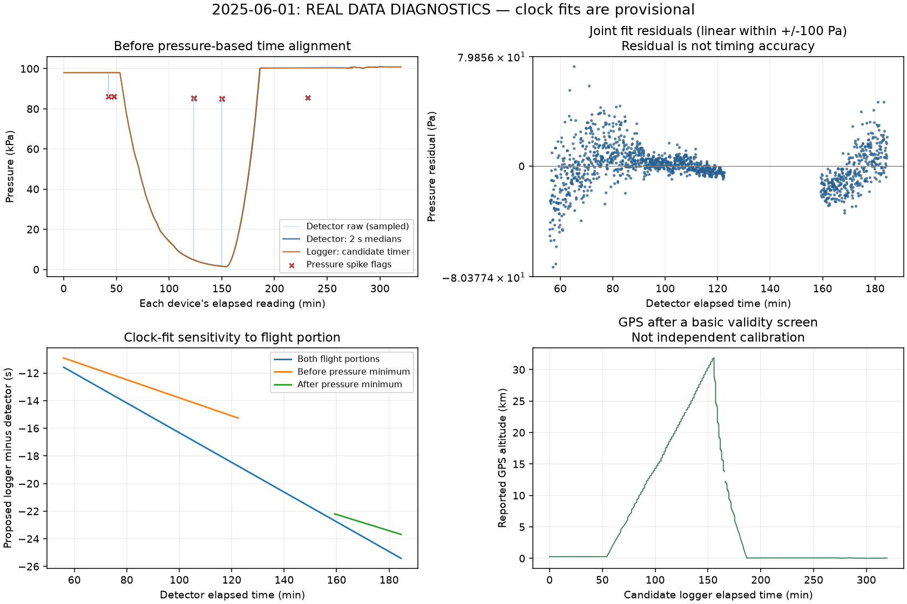
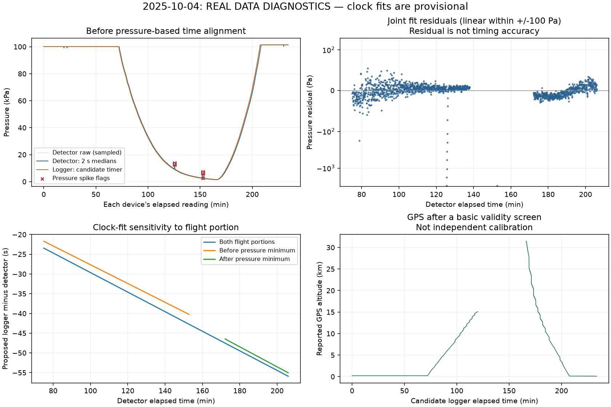
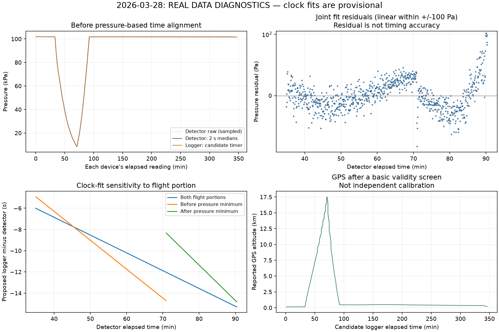

# HERA real-data diagnostics

**Status: DIAGNOSTICS_COMPLETE_TRAINING_PENDING**

These are measurements from the original real recordings. No model was trained. No training table, verified metadata, CPS result or Pfotzer peak was produced.

| Flight | Detector events | Timer wraps (candidate) | RTC backwards steps | Deadtime/span* | GPS max (km)** |
| --- | ---: | ---: | ---: | ---: | ---: |
| 2025-06-01 | 232,931 | 4 | 12,552 | 0.250% | 31.85 |
| 2025-10-04 | 244,351 | 3 | 8,525 | 0.350% | 31.45 |
| 2026-03-28 | 120,808 | 4 | 1,731 | 0.145% | 17.53 |

*Assumes the header's seconds and cumulative-deadtime interpretation. Numerical consistency does not establish continuous acquisition or all sources of lost exposure.

**Basic GPS screen only; neither altitude accuracy nor peak coverage is established.

## What the checks establish

- The input files match the recorded SHA-256 fingerprints.
- Full detector timestamps, event IDs and deadtime increments were inspected; exact issue counts are in summary.json.
- Adding 4294.967296 seconds at each qualifying timer drop gives an increasing candidate logger clock. This is the 2^32-microsecond hypothesis; firmware or an independent clock must confirm it.
- The displayed date/time moves backwards within recordings. In June the date advances near 20:00, so it must not be treated as a clean absolute clock without checking date/time conventions.
- Both devices' pressure traces can be compared. Their fitted timing depends on the flight portion and pressure-response assumptions. Matching pressure curves is not proof of synchronization to 2.5 seconds.
- A few isolated detector pressure readings are flagged. These are review flags, not deleted radiation events.
- Logger event counters and detector event rows represent different measurements. Do not pool them or obtain a count rate by counting logger rows.

## GPS coverage that needs attention

The longest intervals between readings that pass the GPS screen are listed below. These durations use the candidate logger clock. A gap does not mean the detector stopped recording; it means those events lack GPS readings that pass this screen.

- 2025-06-01: 0.74 minutes.
- 2025-10-04: 46.19 minutes.
- 2026-03-28: 0.48 minutes.

October's roughly 46-minute interval runs from an accepted altitude near 15.10 km to the next near 31.42 km. It spans a substantial part of ascent. Do not interpolate that entire gap for training or claim a measured ascent peak there. Investigate the GPS flags or an independently matched tracker record. The valid descent data can be assessed separately. Exact intervals are in summary.json.

## Needed to finish scientific preprocessing

1. Logger source code/version (Timer[S], date/RTC construction, units), any shared start-time or synchronization record, and an independent tracker/GPS record for the October flight if available.
2. CosmicWatch firmware/version/configuration used for these specific flights, plus known pauses, resets, losses or changes of recording mode. Confirm cumulative Deadtime[s] and what acquisition losses it covers.
3. Detector identity, trigger threshold, geometry/orientation and singles/coincidence mode for each flight. Confirm logger acceleration/magnetic units and whether temperature is ambient or inside the payload.

You can obtain these from the experiment team. The filename 'AxLab' by itself does not identify a calibrated detector. Existing project v2.1 slides support cumulative deadtime, but do not document each flight's settings.

## Method and limits

The pressure comparison uses medians in 2-second intervals, retains every second occupied detector interval, selects detector pressure strictly between 5,000 and 90,000 Pa, and excludes 600 seconds at either logger edge. These are diagnostic choices, not a validated sensor operating range. The joint fit uses both sides of the pressure minimum. Separate fits examine the portions before and after that minimum.

The fit minimizes soft-L1 pressure residuals with a 100 Pa scale and parameters: clock offset at the pivot, relative clock slope (ppm), pressure gain and pressure bias. Bounds are +/-300 s, +/-10,000 ppm, 0.95–1.05 and +/-1,000 Pa. No radiation counts, CPS, altitude peaks or ML score is used to fit clocks. Pressure gain/bias are nuisance parameters, not a new sensor calibration. Fit success is numerical only; bounds, overlap and gaps are recorded in summary.json. Do not copy these fitted numbers into a verified manifest.

Pressure spike flags compare each event's pressure with its centered 10-second median, using a difference greater than max(1,000 Pa, 5% of that median). This is not a final cleaning rule. Flagged pressure readings are omitted from the diagnostic pressure fit only; no original value or event is altered. The GPS screen requires at least four satellites, finite coordinates within geographic bounds, a location other than (0,0), and altitude from -500 to 60,000 m. It does not detect every stale or inaccurate fix.

No ADC value at the header's upper limit is not evidence that the analog electronics never saturated. Likewise, an event-time gap alone cannot distinguish a quiet interval from an acquisition pause.

## After the outstanding details are resolved

Build and review the synchronized training table, preserve gaps and exposures, then calculate measured profiles. Run XGBoost with entire flights held out; tune hyperparameters using only the remaining flights. Three flight groups support an exploratory experiment, with limited evidence for generalization. Many rows from one flight do not create many independent flights. Predictive relationships do not establish causation.

For future flights, retain separate original files and flight settings, evaluate the frozen model first, and then create a new version for retraining. Do not mix data from a future test flight into tuning.

## 2025-06-01

## 2025-10-04

## 2026-03-28

