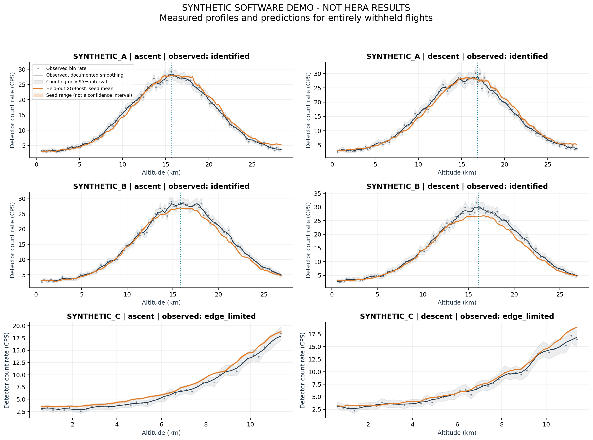
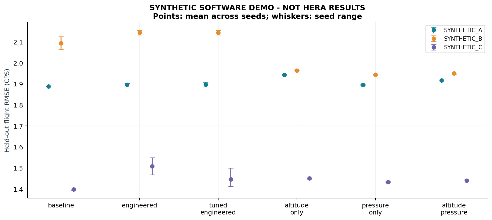

# Radiation Profiles & Pfotzer Peak Estimation

> Map continuous atmospheric radiation curves to precisely locate the Pfotzer-Regener maximum and generate standardized profiles for cross-flight comparison.

## Status

**SYNTHETIC SOFTWARE DEMONSTRATION ONLY. No real HERA training or empirical peak estimates.**

Processed 3,642 rows from 3 independent flight groups. Used seeds [11, 42, 73]; six XGBoost feature/tuning variants when running the default protocol. Each test flight was excluded from all inner tuning.

## Held-out row prediction

Each flight is averaged over seeds first. The table averages those flight means equally. The spread is between flights, not a confidence interval. Negative changes versus baseline indicate improvement.

| XGBoost variant | Mean flight RMSE (CPS) | Between-flight SD (CPS) | Mean flight MAE (CPS) | Mean flight R2 | RMSE change vs baseline |
|---|---:|---:|---:|---:|---:|
| altitude_only | 1.786 | 0.291 | 1.340 | 0.936 | -0.007 |
| altitude_pressure | 1.769 | 0.285 | 1.327 | 0.937 | -0.024 |
| baseline | 1.793 | 0.358 | 1.352 | 0.937 | +0.000 |
| engineered | 1.850 | 0.321 | 1.405 | 0.931 | +0.056 |
| pressure_only | 1.758 | 0.282 | 1.320 | 0.938 | -0.036 |
| tuned_engineered | 1.829 | 0.354 | 1.386 | 0.934 | +0.036 |

These differences describe this fixed run. They are not a guarantee of improvement on future flights.

## Profile and peak evaluation

| Variant | Mean profile RMSE (CPS) | Both peaks identified / evaluated flight-phase-seed pairs | Mean absolute peak difference (m), identified pairs only |
|---|---:|---:|---:|
| altitude_only | 1.079 | 12/18 | 417 |
| altitude_pressure | 1.050 | 12/18 | 375 |
| baseline | 1.073 | 12/18 | 562 |
| engineered | 1.157 | 12/18 | 271 |
| pressure_only | 1.020 | 12/18 | 375 |
| tuned_engineered | 1.124 | 12/18 | 312 |

These peak differences compare two empirical reconstructions, not predictions against an independently known physical peak. Identification coverage is reported to expose selection bias in the error average.

## Interpretation limits

- Three independent flights give only two training groups per outer fold; inner validation trains on one and validates on one. Seeds do not increase the number of independent flights.
- The model uses environmental measurements from the completed held-out flight, including centered trajectory derivatives. It is an offline reconstruction, not a real-time forecast.
- All observed/predicted profiles use the same bins and observed trajectories. Empty or sparse bins remain unsupported. No curve extends beyond observed altitude coverage.
- The reported identified status means a candidate passes explicit screening rules. Instrument response, calibration and atmospheric interpretation still require review.
- Conditional Poisson counting intervals exclude detector calibration, atmospheric variation and model error. Seed ranges and sensitivity ranges are not scientific confidence intervals.
- Bin widths 100, 250 and 500 m and smoothing widths 1 and 3 bins are saved as sensitivity analyses; none are selected to minimize outer-test error.
- Gain and grouped circular perturbation importances describe associations. Correlated predictors, disrupted sensor relationships and detector differences limit interpretation.
- Absolute count rates are detector CPS, not radiation dose or calibrated flux. Hardware consistency must be reviewed before comparing absolute rates.

## Reproducibility

The run includes the exact configuration, package versions, input hash, exclusions, split audit, complete search history, held-out predictions and all fitted outer-fold models. The separate final refit is for future data and has no independent test score.
