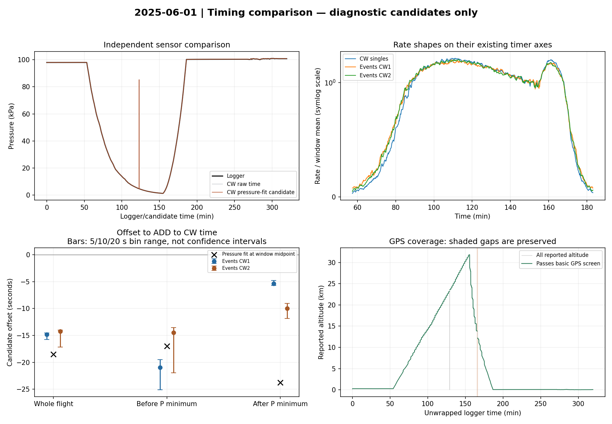
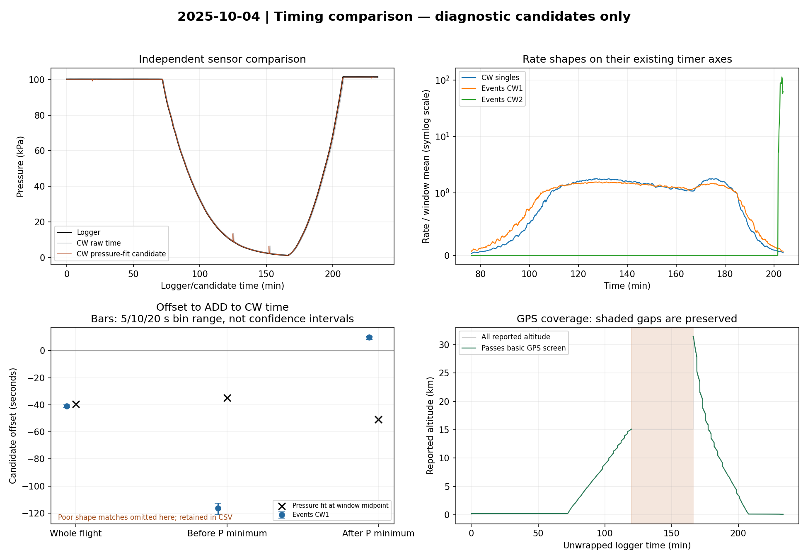
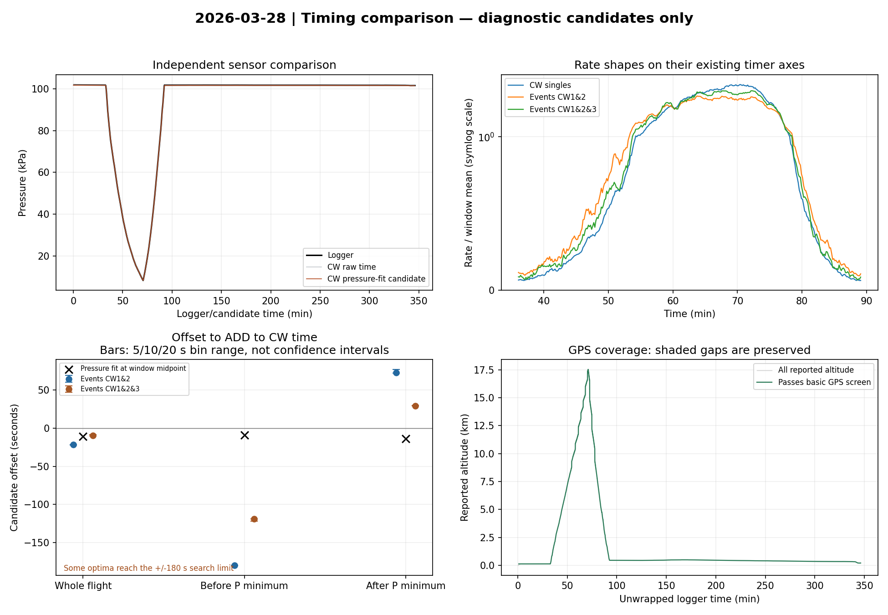

# HERA time-matching review — 14 October 2026

**Status: TIMING_REVIEW_COMPLETE_TRAINING_PENDING**

Six original real-data files were checked before and after the run. No original recordings were changed. No real-data model was trained. Calibration remains deferred.

## What changed after the professor’s reply

- The logger temperature is inside the payload. It is now named box_temperature_c in the real-data feature matrix. It is not used as outside-air temperature and is not used to calculate atmospheric density.
- Uncalibrated magnetic readings and acceleration with unconfirmed units are excluded from the main real-data feature sets. The original sensor columns remain in the raw files.
- METEOR APRS temperature is reported to be outside the box. No APRS series has been merged without a confirmed payload/time match.
- Detector amplitude calibration is deferred. Emma’s ground-calibration code was reviewed, not applied.
- The synthetic demonstration remains a software exercise; its feature settings are unchanged.

## Source review

Annafy’s local and Colab notebooks expect an already timer-corrected, battery-filtered AHD011 file. Their fixed search windows refer to that example dataset, not automatically to these three flights. June and October have Events CW1 / Events CW2 columns; March has Events CW1&2 / Events CW1&2&3.
Emma’s calibration_methods.py explicitly uses 4294.967296 seconds per logger wrap. This corroborates the earlier numerical hypothesis, but is analysis code rather than proof of the exact flashed firmware. The local helper rejects backward jumps that do not satisfy the high-to-low wrap rule.
Emma’s calibration workflow fits per-scintillator amplitude peaks in ground/coincidence data and can reuse values from the same detector. Its example MPVs and gain-temperature fits were not transferred to our recordings.

## Reproducible sign error in the supplied alignment calculation

Both reviewed notebooks correlate a reference with np.roll(source, k), then apply the negative of the resulting shift to source timestamps. For this convention the returned shift itself is the offset to add. In the planted +60 s test, the supplied mapping adds +60 s instead of -60 s, leaving a +120 s mismatch. The -40 s and zero-delay controls are also recorded. The original notebook function was extracted and checked without running its download, upload, plotting or file-writing cells.
The local diagnostic implementation uses the corrected sign and real overlapping intervals. It does not wrap the end of a flight onto its beginning. No GitHub or Drive source was edited.

## Results on the three real flights

| Flight | Timer wraps | Whole-flight count-shape offsets* | Longest accepted GPS gap | Training ready |
| --- | ---: | --- | ---: | --- |
| 2025-06-01 | 4 | -17.2 to -14.0 s | 0.74 min | No |
| 2025-10-04 | 3 | -41.8 to -40.2 s | 46.19 min | No |
| 2026-03-28 | 4 | -21.9 to -8.1 s | 0.48 min | No |

*These are offsets estimated from count-curve shape, across logger channels and 5/10/20 s bins, excluding poor shape matches and boundary optima. They are not final clock corrections or confidence intervals. The full per-window results are in alignment_candidates.csv.
The estimates change with flight portion, bin size and radiation channel. In some windows the optimum reaches the search boundary, or a logger counter has too few events to estimate a shift. October CW2 has a different late-burst shape and fails the correlation screen. Its estimates remain in the CSV but are excluded from the summary range. Even a high correlation is not evidence of timing accuracy.
Two logger counters share one timestamp column. Their apparent relative shift is a useful control for shape and counting effects, not a real offset between two clocks. We keep that logger clock fixed.
Pressure-based estimates use no radiation counts or peak positions and provide an independent comparison. They also depend on pressure sensor response and flight portion; pressure residuals are not timing error bars. The present checks do not establish the project’s 2.5-second synchronization requirement.
October’s approximately 46.2-minute interval is between accepted ONBOARD logger GPS readings. The professor’s explanation about intermittent APRS reception does not, by itself, resolve that onboard gap. No altitude is interpolated across it.

## Files produced and what they can be used for

- alignment_candidates.csv: corrected-sign count-shape comparisons and same-clock controls. Diagnostic use only.
- gps_supported_intervals.csv: intervals passing the basic GPS screen, split at gaps above 30 seconds. These are not approved training intervals.
- *_review_bins_NOT_FOR_TRAINING.csv: conditional rates in full 30-second bins, with a pressure-fit candidate time map. Every row has training_ready=False and source_kind=real_hera_review_only. These files are not the project’s combined.csv.
- checks/: fresh raw-data checks, pressure-fit details, timing jumps and GPS coverage evidence.
- source_review.json and validation records: exact source references/hashes and the known-delay test.

The review-bin rates subtract linearly interpolated cumulative deadtime from the 30-second interval. That assumes continuous acquisition and the documented cumulative-seconds interpretation. No verification flag is enabled merely because the counters look consistent. A GPS value is joined only if an accepted logger fix is within 2.5 seconds of the candidate mapped bin centre; this nearby-sample distance is NOT proof of clock accuracy.

## What is still needed before real training

A defensible timing map for each exact file pair, including its uncertainty and usable intervals, is still needed. Ask the team to review the sign-test result and the per-flight comparisons. A recorded common event, sync pulse, known start/end reference, or other independent timing evidence would help distinguish clock offset/drift from different rate shapes. The preparation that produced AHD011_timer_corrected_battery_filtered.csv is also relevant; it is not supplied by the notebook reader.
Recording continuity/exposure and each file’s detector mode/identity still need review. This is separate from the deferred amplitude calibration. Keep RUN_TRAINING=False and keep the manifest unverified. Do not fill in the fitted candidate offsets as verified values.
After those items are resolved, create the reviewed training table. Hold out whole flights, tune hyperparameters only on the other flights, and retain future flights as a new test set. Three flights remain a small exploratory study.

## Reproducible diagnostic settings

Windows come from ten-second logger pressure medians: the first/last values below 85,000 Pa, split at the pressure minimum, bounded by a 200-second recording-edge margin. These are diagnostic choices, not validated operating limits. Radiation curves use 5, 10 and 20-second bins, roughly 60 seconds of smoothing, ±180-second offset searches, at least 75% overlapping bins, and at least 100 counts per compared series/window. Correlations below 0.8 are marked rejected_shape_match; this is a diagnostic screen, not an accuracy guarantee. No peak location or model score selects the windows or fitted pressure map. The basic GPS screen and pressure fit follow diagnose_real_data.py; exact inputs, code hashes and versions are recorded.

## 2025-06-01

## 2025-10-04

## 2026-03-28

